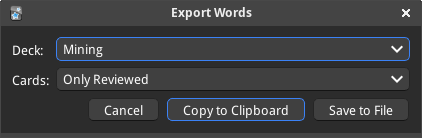

> ⚠️ AI Slopa warning ⚠️
>
> - Entirely vibe codded

# Export Words (Anki add-on)

Exports every word from a deck as a comma-separated list, ordered from the
oldest card to the newest.  The result can be copied to the clipboard or saved
to a text file.

- Only the first field of each note is used.
- HTML is stripped; duplicates are removed.
- Subdecks are included when a parent deck is selected.
- Saved files use UTF-8 and contain the same comma-separated text.

## Usage

Pick any of these:

- Use **Tools → Export words...**
- Click on deck's gear/options menu → **Export words...**

## Installation

**Tools → Add-ons → Install from file...** in Anki.
